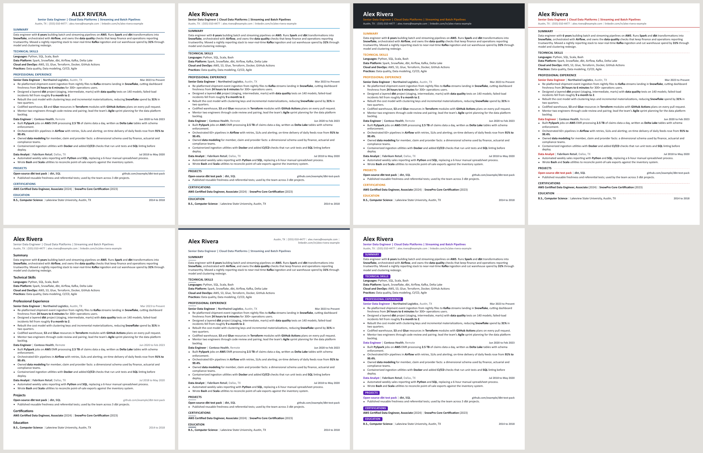

# ATS Resume Forge

An open-source resume builder made for AI agents and for people. Give it a `resume.json`, and it produces an ATS-safe HTML resume, a verified PDF, and, if you want, a live web page on Vercel.

- **Seven distinct templates.** All single column, real selectable text, system fonts, no icons or images: the layout parsers in Workday, Greenhouse, Lever, iCIMS, Taleo and SmartRecruiters read cleanly.
- **Fits the page for you.** Searches for the largest font size (8.2pt to 11pt) that keeps the resume within your page limit.
- **Verifies every PDF.** Page count, selectable text, name first, section headings, must-have keywords, no em/en dashes, no browser header or footer junk.
- **Honesty checks.** `lint` flags skills that are listed but never evidenced in a bullet, overlong bullets, and lopsided role weighting.
- **One command to a website.** A static, `noindex` page with a Download PDF button, deployable to Vercel.
- **Agent skill included.** `skills/ats-resume-forge/SKILL.md` teaches Claude Code (or any coding agent) the full workflow: evidence inventory, job decomposition, gap questions, truthful tailoring, render, verify, deploy.
- **Zero dependencies.** Node 18+ and Chrome, Edge or Chromium. `pdftotext` (poppler) enables the text checks.

Live demo (fictional candidate): https://ats-resume-forge-demo.vercel.app



## Quick start

```bash
git clone https://github.com/ItsmeBlackOps/ats-resume-forge.git
cd ats-resume-forge
node bin/resumeforge.mjs init my-resume.json      # copies the fictional sample
# edit my-resume.json with your real, evidenced content
node bin/resumeforge.mjs lint my-resume.json
node bin/resumeforge.mjs pdf my-resume.json --out out/me
```

Optional: `npm link` once, then use `resumeforge` anywhere.

## Commands

| Command | What it does |
|---|---|
| `init [file]` | Copy the sample `resume.json` to start from |
| `templates` | List templates and how often you have used each in this folder |
| `lint <resume.json>` | Content checks: unevidenced skills, dashes, long bullets, bullet balance |
| `html <resume.json>` | Write the HTML only |
| `pdf <resume.json>` | Build, fit to the page limit, print the PDF, verify it |
| `verify <file.pdf>` | Verify any PDF (`--keywords a,b,c`, `--max-pages n`) |
| `site <resume.json>` | PDF plus a static site folder ready for Vercel |
| `deploy <siteDir>` | `vercel deploy --prod` (needs `vercel login` or `VERCEL_TOKEN`) |
| `all <resume.json>` | lint, pdf, verify and site in one go; add `--deploy` to publish |

Useful options: `--template <name>`, `--out <dir>`, `--max-pages <n>`, `--font-size <pt>`, `--accent <#hex>`, `--keywords <a,b>`, `--site-dir <dir>`.

The browser is found automatically on Windows, macOS and Linux. Set `RESUMEFORGE_BROWSER` to point at a specific Chrome, Edge or Chromium executable.

## Using it with an AI agent

**Claude Code:** copy the skill into your skills folder, then ask in plain language.

```bash
# macOS / Linux
cp -r skills/ats-resume-forge ~/.claude/skills/
# Windows (PowerShell)
Copy-Item -Recurse skills\ats-resume-forge $HOME\.claude\skills\
```

Then, from inside this repo:

> Here is my resume (resume.pdf) and the job description (jd.txt). Tailor it, give me the PDF, and deploy a web version.

The agent builds an evidence inventory, asks you about gaps instead of guessing, writes `resume.json`, picks a template you have not used, renders, verifies, and reports what is still only a partial match, plus interview questions to rehearse.

**Other agents** (Codex, Cursor, Copilot, Gemini CLI): `AGENTS.md` points them at the same skill file and CLI.

## The honesty rules

The skill is strict on purpose. A resume that wins a screen and loses the interview wastes everyone's time.

1. Every claim traces to the candidate's own evidence.
2. Job titles and dates are never changed.
3. Claims are calibrated to how long each role lasted.
4. Every listed skill is backed by a bullet.
5. Partial matches are written as partial.
6. Metrics are real or absent.
7. One candidate's details never leak into another's resume.

## Privacy

This repository contains **no real resumes**. The only candidate in it, Alex Rivera, is fictional, as are every employer and number in the sample. Your own files stay on your machine: `candidates/`, `out/`, `resume.json`, generated PDFs and `.resumeforge/` are all gitignored. Deployed sites send `X-Robots-Tag: noindex, nofollow`, but anyone with the link can still open them, so share links deliberately.

## Templates

| Name | Look |
|---|---|
| `meridian` | Centered masthead, navy headings with a rule below |
| `ledger` | Left-aligned, hairline accent rule above each heading |
| `bandline` | Charcoal header band, amber headings |
| `leader` | Crimson headline, dotted leader after headings |
| `quiet` | Monochrome, hierarchy by weight only |
| `tick` | Slate top stripe, split masthead, short accent tick |
| `pill` | Violet reversed pill headings |

Adding one is a single CSS file in `templates/` plus an entry in `templates/manifest.json`. Keep it single column and text only.

## Contributing

Issues and pull requests are welcome: new templates, A4 refinements, more verification checks, other deploy targets. Please never include real personal data in issues, fixtures or screenshots.

## License

MIT
